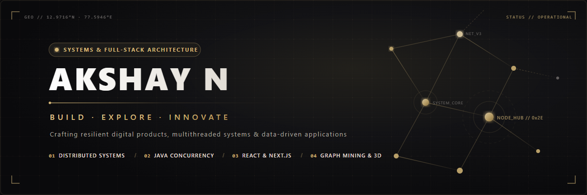

# AKSHAY N

**Software Developer · Problem Solver · Technology Enthusiast**

*"Building practical solutions through code, creativity, and continuous learning."*

 

---

## 🧭 About Me

I am a software engineer focused on building resilient full-stack applications, distributed backend services, and interactive data visualization systems. My approach to engineering is grounded in first-principles thinking: understanding how memory, concurrency, and network layers operate beneath the framework abstractions.

My development journey spans:
- **Full-Stack Engineering:** Developing modern, high-performance web applications using **React 19**, **Next.js 16**, **TypeScript**, and **Tailwind CSS**.
- **Backend & Systems Programming:** Building concurrent services and clean architectures using **Java 21**, **Spring Boot 3**, and **Python**.
- **Algorithmic Problem-Solving:** Applying graph algorithms, data compression (Huffman coding), and shortest-path routing (Dijkstra) to solve real-world problems.
- **Hardware & Desktop Telemetry:** Designing low-latency Windows performance monitors with real-time hardware telemetry and in-game overlays.
- **Data Mining & 3D Visualization:** Creating spatial network visualizers with **Three.js** to explore complex skill and career topologies.

I learn by prototyping, measuring performance, analyzing race conditions, and iterating until systems are dependable and scalable.

---

## 🛠️ Technical Skills

- **Languages:** Java · Python · JavaScript · TypeScript · SQL · Kotlin
- **Frontend:** React · Next.js · Tailwind CSS · HTML · CSS
- **Backend & Databases:** Spring Boot · Node.js · Express.js · Flask · MySQL · PostgreSQL · MongoDB
- **Tools & Visualization:** Git · GitHub · Docker · Vercel · Render · Three.js · Android Studio

---

## 🚀 Featured Engineering Projects

A curated selection of production systems, algorithmic tools, and multithreaded simulations engineered from scratch.

### 01 // NETGRAPH — 3D Network Graph Mining & Career Intelligence
> *Interactive 3D WebGL network exploration platform analyzing relationships between technical skills, projects, and career paths.*

- **Interactive 3D Graph Visualization:** Built with Three.js to provide spatial navigation, node inspection, and visual cluster exploration.
- **Relational Career Analytics:** Models relationships between technical skills, projects, and career opportunities to identify skill adjacencies and gaps.
- **Full-Stack Implementation:** Built using Next.js 16 App Router, React 19, Prisma ORM, and Neon PostgreSQL.

`Next.js 16` · `React 19` · `TypeScript` · `Three.js` · `Prisma ORM` · `PostgreSQL (Neon)` · `Tailwind CSS v4`
[**🌐 Live Demo**](https://net-graph.vercel.app) &nbsp;|&nbsp; [**📁 Source Code**](https://github.com/akshayabhi0005-web/NetGraph)

---

### 02 // VYROX — Smart Commerce Platform
> *A multi-client commerce application connecting an Android mobile client and web portal to a centralized Spring Boot backend.*

- **Multi-Client Architecture:** Connects a native Android application (Kotlin + Jetpack Compose) and an administrative web portal (React + TypeScript) to a shared backend.
- **REST API Backend:** Implements product catalog management, user authentication, and order processing using Spring Boot 3 with Java 21.
- **Assistance & Tracking Services:** Integrates an AI shopping assistant and real-time delivery GPS tracking services.

`Spring Boot 3` · `Java 21` · `Kotlin` · `Jetpack Compose` · `React` · `TypeScript` · `Docker`
[**📁 Source Code**](https://github.com/akshayabhi0005-web/VYROX)

---

### 03 // BankSafe — Multithreading Concurrency & Race Condition Visualizer
> *An interactive Java concurrency simulation platform that visualizes thread synchronization, race conditions, and deadlock scenarios.*

- **Three Concurrency Simulation Modes:** Demonstrates thread behavior with synchronized locking, unsynchronized race conditions leading to balance drift, and circular resource deadlock.
- **Real-Time Visual State Tracing:** Traces concurrent thread operations, lock acquisition states, and shared balance updates in real time.
- **Dockerized Execution:** Packaged with Docker and batch scripts for consistent local testing and reproducible execution.

`Java 21` · `Multithreading` · `Thread Synchronization` · `Event-Driven Simulation` · `Docker`
[**📁 Source Code & Execution Guide**](https://github.com/akshayabhi0005-web/BankSafe-)

---

### 04 // SHM (System Health Monitor) — Windows Hardware Telemetry & Gaming Overlay
> *A low-overhead Windows desktop performance monitor providing real-time hardware metrics and an in-game HUD overlay.*

- **Hardware Performance Tracking:** Samples real-time CPU, GPU, RAM, VRAM utilization, temperatures, and fan speeds.
- **In-Game Overlay HUD:** Features a toggleable gaming HUD overlay displaying live FPS tracking and frametime pacing graphs.
- **System Health Alerts:** Displays hardware metrics and visual warning indicators when predefined operational thresholds are approached.

`TypeScript` · `Java Native Integrations` · `Windows Hardware APIs` · `CSS`
[**📁 Source Code**](https://github.com/akshayabhi0005-web/System-Health-Monitor-SHM-)

---

### 05 // FuelGuard AI — Fuel Monitoring & Anomaly Detection
> *A web-based fuel monitoring platform designed to identify suspicious fuel transactions and flag consumption anomalies.*

- **Anomaly Detection:** Evaluates fuel transaction logs against baseline consumption patterns to detect irregular volume dispensing and potential fraud.
- **Management Dashboard:** Displays risk indicators, visual transaction logs, and operational alert feeds for fleet supervisors.
- **Cloud-Deployed Web App:** Hosted as a full-stack web application on Render with interactive client-side dashboards.

`JavaScript` · `Node.js` · `Statistical Anomaly Detection` · `REST APIs` · `Render Cloud`
[**🌐 Live Demo**](https://fuelguard-ai-1.onrender.com) &nbsp;|&nbsp; [**📁 Source Code**](https://github.com/akshayabhi0005-web/FuelGuard-AI)

---

### 06 // Smart Traffic Optimization — Real-Time IoT Routing & Traffic Simulation
> *A smart city traffic dashboard utilizing Huffman Coding for IoT data compression and Dijkstra's Algorithm for dynamic route optimization.*

- **Shortest-Path Optimization:** Applies Dijkstra's algorithm across dynamic road network graphs to reroute simulated vehicles around congested junctions.
- **IoT Payload Compression:** Implements Huffman coding on sensor telemetry packets to reduce data transmission payload size.
- **Live Traffic Simulation:** Visualizes road intersections, traffic density changes, and dynamic rerouting decisions in real time.

`JavaScript` · `Dijkstra's Algorithm` · `Huffman Coding` · `Traffic Simulation Engine` · `CSS3`
[**📁 Source Code**](https://github.com/akshayabhi0005-web/Smart-Traffic-Optimization)

---

## 📊 GitHub Telemetry & Activity

<table border="0">
<tr>
<td align="center">
  
</td>
<td align="center">
  
</td>
</tr>
<tr>
<td colspan="2" align="center">
  
</td>
</tr>
</table>

---

## 🔭 Current Focus & Exploration

- ⚡ **High-Throughput Microservices:** Deepening experience with **Spring Boot 3**, distributed event buses, and asynchronous task execution.
- 🧩 **Advanced Data Structures & Algorithms:** Practicing graph theory, dynamic programming, and concurrency primitives in **Java**.
- 🌐 **Modern Frontend Frameworks:** Pushing the boundaries of **Next.js 16**, React Server Components, and interactive 3D WebGL interfaces.
- ☁️ **Cloud Native Scalability:** Exploring container orchestration with Docker and zero-downtime deployment pipelines.

---

## 🤝 Connect & Collaborate

Whether you are looking to discuss distributed systems, collaborate on an open-source project, or review code architecture, my inbox is always open.

 

  

*"Quality software is crafted through curiosity, persistence, and continuous refinement."*

 

© 2026 Akshay N · Engineered with precision

