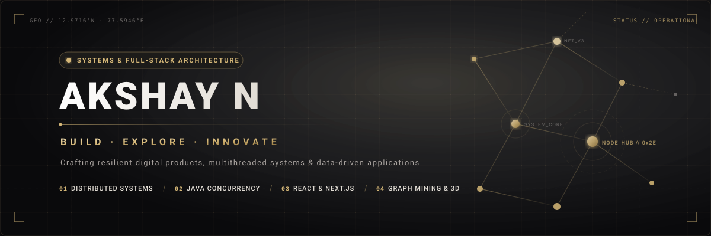
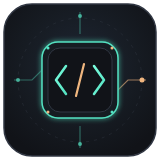

  
    
  
 

---

 

<table>
  <tr>
    <td width="34%" align="center" valign="top">
       
      
        
      <h3>AKSHAY N</h3>
      
<b>Software Developer</b>

      
<i>"Building. Experimenting. Improving."</i>

      

      

        ⚡ &nbsp;<b>Full-Stack Development</b> 
        🧠 &nbsp;<b>Algorithms &amp; Problem Solving</b> 
        🛠️ &nbsp;<b>Backend Engineering</b>
      

    </td>
    <td width="66%" valign="top">
      <h3> About Me</h3>
      

        I am a software developer with a focus on engineering clean, scalable full-stack applications and resilient backend systems. My work centers on applying core computer science fundamentals—data structures, algorithmic efficiency, and modular system design—to practical engineering challenges.
      

      

        I enjoy working across the full application lifecycle: modeling relational and document-oriented databases, building performant RESTful APIs, and developing responsive, intuitive user interfaces with modern web standards.
      

      

        My focus is on writing maintainable, well-structured code, understanding architectural trade-offs, and transforming complex requirements into dependable, production-ready software.
      

    </td>
  </tr>
</table>

 
## 🛠️ My Tech Stack

<table>
<tr>
<td align="center" width="50%">

### Languages

 

</td>
<td align="center" width="50%">

### Frontend

 

</td>
</tr>

<tr>
<td align="center" width="50%">

### Backend

</td>
<td align="center" width="50%">

### Database & Cloud

 

</td>
</tr>
</table>

---

## 📈 GitHub Analytics

  
  
   
  

---

## 🎯 What I Believe In

<table>
  <tr>
    <td align="center" style="border: 1px solid #0B6B50; border-radius: 12px;">
       
      <h2>“Do What You Love, Love What You Do”</h2>
      
<a href="https://github.com/akshayabhi0005-web"><strong>@akshayabhi0005-web</strong></a>

       
    </td>
  </tr>
</table>

---

## 🧠 Engineering Mindset

| 🚀 Build Fast | 🎯 Quality Over Quantity | 🤝 Community First | 📚 Never Stop Learning |
|:---:|:---:|:---:|:---:|
| Ship, iterate, improve | Clear code over needless complexity | Share ideas and learn together | Keep growing with technology |

---

## 🤝 Let's Connect

I'm always happy to connect with people who enjoy learning, building, and exchanging ideas.

  
Made with curiosity, consistency, and ☕

